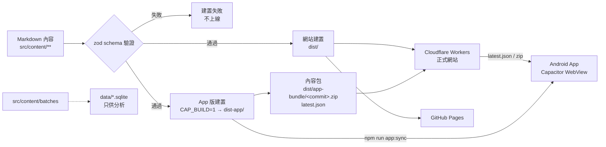
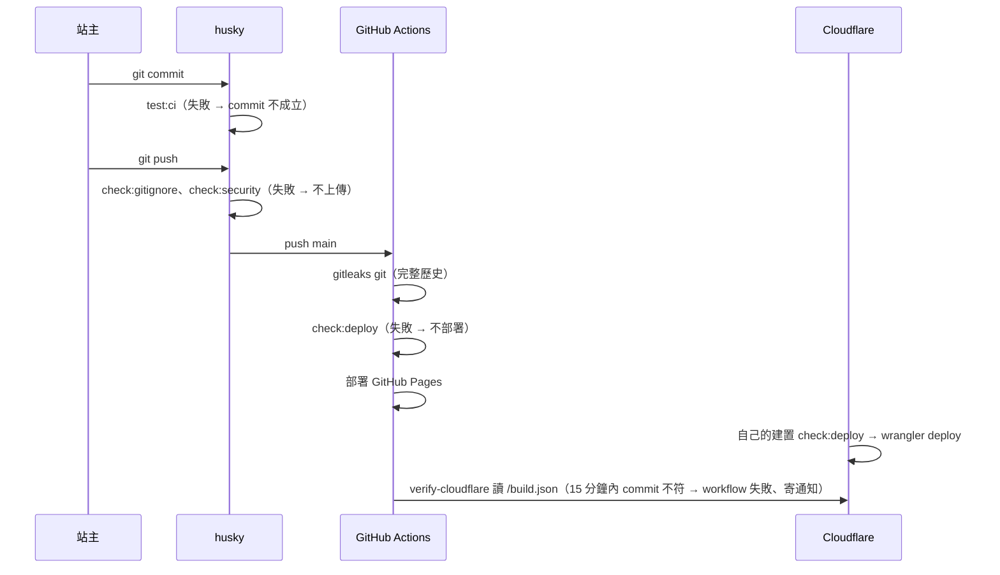
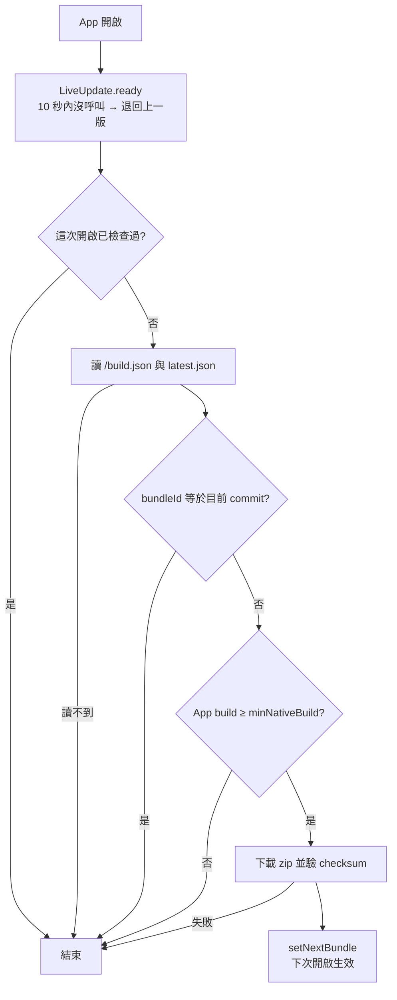

# 技術規格：YogurtGuide 網站與 Android App

| 欄位 | 值 |
|---|---|
| 名稱 | YogurtGuide 網站與 Android App |
| 版本 | 1.0 |
| 狀態 | 範例（依 2026-11-02 的程式碼反推） |
| 日期 | 2026-11-02 |
| 需求規格 | `checklist.md` 1.0 |

---

## 1. 摘要

內容全部寫成 Markdown，建置時用 schema 驗證，產出純靜態網站（R-06）。同一份原始碼用另一組設定建置出 App 版，由 Capacitor 包成 Android App（R-07）。App 內容靠自架的 Live Update 更新：建置時把 App 版壓成內容包並發布 `latest.json`，App 啟動時比對並在背景下載。

第 2 階段的紀錄（R-09、R-10）只存在手機，用本機資料庫與原生外掛實作，網站不受影響。

## 2. 技術背景

| 項目 | 選擇 |
|---|---|
| 語言 | TypeScript、Node.js 24 |
| 網站框架 | Astro（靜態輸出）、Content Collections＋zod schema |
| App | Capacitor 8（Android）、`@capawesome/capacitor-live-update` |
| Android 建置 | JDK 21、Gradle；簽章讀 repo 外的 keystore |
| 儲存 | 內容：Markdown（`src/content/**`）。批次另可匯出 SQLite（`data/*.sqlite`，頁面不讀）。App 紀錄：手機本機資料庫（第 2 階段，`[待確認]` 外掛） |
| 測試 | `node --test`（`tests/`）；`test:ci` 要求至少一個測試檔 |
| 部署 | Cloudflare Workers（正式，`base=/`）；GitHub Pages（`base=/YogurtGuide/`） |
| CI | GitHub Actions：gitleaks（完整歷史、SHA-256 驗證）＋`check:deploy` |
| 限制 | 單檔 ≤ 25 MiB（Cloudflare）；不用 Cloudflare token 於 GitHub；不建 iOS |

## 3. 原則檢查（對 `AGENTS.md`）

| 原則 | 結果 |
|---|---|
| 頁面只讀 Markdown，不讀 SQLite | 通過 |
| 菌粉頁不放店名與連結；缺資料用固定文字 | 通過（`powders/index.astro`） |
| 隔夜燕麥份量規則寫錯會讓 build 失敗 | 通過（zod schema） |
| 不手改 `dist/` | 通過（全部由建置產出） |
| 原生改動要同時加 `nativeBuild` 與 `versionCode` | 通過（`latest.json` 帶 `minNativeBuild`） |
| keystore、`key.properties` 不進版控 | 通過（`.gitignore`＋`check:gitignore`） |
| Cloudflare token 不放 GitHub secrets | 通過（Cloudflare 自己的 Git 連線建置） |

## 4. 架構



| 元件 | 負責 | 不負責 |
|---|---|---|
| Content Collections | 讀 Markdown、驗證欄位 | 呈現 |
| 頁面（`src/pages`） | 把資料排成 HTML | 資料規則（交給 schema） |
| `PackShots.astro` | 包裝圖翻頁（菌粉、市售優格共用） | 圖片來源 |
| `scripts/build-app.mjs` | App 版建置、連結改寫、壓包、`latest.json` | 網站建置 |
| `AppLiveUpdate.astro` | App 啟動檢查與下載新內容包 | 套用時機以外的 UI |
| `app-content/v1/*.json` | 給 App 用的結構化清單 | 頁面（頁面直接讀 collection） |

## 5. 目錄結構

```text
src/
├── content/            # 內容（9 個 collection）
├── content.config.ts   # schema
├── pages/              # 頁面；app-content/v1/ 產出 JSON
├── components/         # PackShots、AppLiveUpdate…
├── config/platforms.ts # nativeBuild、liveUpdateUrl
└── lib/content-api/    # App JSON 的產生與雜湊
scripts/                # build-app、CI 檢查、SQLite 匯入
tests/                  # node --test
android/                # Capacitor Android 專案
public/                 # 照片、字體、授權全文
.github/workflows/      # ci.yml、deploy.yml
```

## 6. 資料模型

| Collection | 主要欄位 | 唯一識別 |
|---|---|---|
| `batches` | 日期、保溫溫度、發酵時間、菌的來源／名稱／代數、評分、照片 | 檔名 |
| `cultures` | 菌種、溫度、來源 | 檔名 |
| `methods` | 製法、控制點 | 檔名 |
| `starterPowders` | 品牌、產品、規格、菌種、價格、評價、包裝圖 | 檔名 |
| `marketYogurts` | 成分、營養標示（每 100 g/ml）、菌種、星等、包裝圖 | 檔名 |
| `overnightOats` | 食材（份量、上限、單位）、步驟 | 檔名 |
| `additives`、`foods`、`glossary` | 名稱、說明 | 檔名 |

**版本與相容**

- App JSON 帶 `schemaVersion`；格式不相容時開 `v2/`，`v1/` 保留到舊內容包不再使用。
- App 紀錄（第 2 階段）存 `schemaVersion`；讀舊資料時先轉換再使用。
- App 紀錄引用菌粉時存 `id`＋當時名稱，產品下架仍可顯示。

## 7. 介面合約

| 編號 | 介面 | 內容 | 錯誤 |
|---|---|---|---|
| IF-01 | `/build.json` | `{ commit }`：這次建置的 commit | 讀不到 → App 視為需要比對，CI 視為未部署 |
| IF-02 | `/app-bundle/latest.json` | `bundleId`、`url`、`checksum`（SHA-256）、`minNativeBuild` | 讀不到或格式錯 → 不更新 |
| IF-03 | `/app-bundle/<commit>.zip` | App 版完整內容，`index.html` 在根目錄 | 雜湊不符 → 外掛拒收 |
| IF-04 | `/app-content/v1/manifest.json` | `contentRevision`、各檔名稱、`sha256`、大小 | — |
| IF-05 | `/app-content/v1/powders.json`、`overnight-oats.json` | `schemaVersion`＋`items` | — |

## 8. 流程

### 8.1 內容發布



### 8.2 App 啟動更新



### 8.3 原生改動

1. 新增外掛或權限 → `nativeBuild`＋1、`versionCode`＋1。
2. 重新產出 AAB 並上架。
3. 舊 App 讀到 `minNativeBuild` 較大的內容包 → 不下載（8.2 的 F）。

## 9. 失敗處理

| 失敗點 | 偵測 | 結果 |
|---|---|---|
| 內容欄位錯 | zod | build 失敗，網站維持上一版 |
| 秘密進 repo | `check:security`、gitleaks | 不上傳／不部署 |
| Cloudflare 沒收到 push | `verify-cloudflare` | workflow 失敗、寄通知 |
| 內容包下載中斷 | checksum | 不套用，下次再試 |
| 新內容包開不起來 | `ready()` 逾時 | 外掛自動退回上一版 |
| App 紀錄儲存中斷（第 2 階段） | 交易 | 整筆不存 `[待確認：外掛是否支援交易]` |

## 10. 安全與敏感資料

- keystore 放 `D:/WadeDev/.keystores/`（repo 外），`android/key.properties` 不進版控。
- Cloudflare API token 只在 Cloudflare 端，不進 GitHub secrets、不進 workflow。
- 第三方 action 釘 40 字元 SHA；gitleaks 下載後驗 SHA-256。
- App 紀錄與照片只在 App 私有空間，不上傳（第 3 階段備份另訂）。

## 11. 技術決策

| 編號 | 決定 | 放棄 | 原因 |
|---|---|---|---|
| D-01 | Markdown＋schema | CMS、資料庫 | 一人維護、版本控制即備份 |
| D-02 | Capacitor 包網站 | 原生重寫 | 內容與網站同一份 |
| D-03 | 自架 Live Update | 付費更新服務、每次重新上架 | 免費、內容天天改 |
| D-04 | 照片從網站讀（方案 B） | 照片打包 | 內容包 9 MB 中照片 8.3 MB |
| D-05 | 雙站部署、各自 `check:deploy` | 單一平台 | 正式站在 Cloudflare，GitHub Pages 當備援 |
| D-06 | 備份用 JSON＋照片分開存 | base64 塞 JSON、Android 自動備份 | 體積多 1/3；自動備份上限 25 MB |

## 12. 需求落點

| 需求 | 落點 |
|---|---|
| R-01 | `BaseLayout.astro` 導覽 |
| R-02 | `batches` schema、`pages/batches/` |
| R-03 | `starterPowders` schema、`pages/powders/index.astro` |
| R-04 | `marketYogurts` schema、`pages/market/index.astro`（星等目前由內容填寫，不由程式計算） |
| R-05 | `overnightOats` schema 的份量規則 |
| R-06 | 8.1 內容發布、9 失敗處理 |
| R-07 | 8.2 App 啟動更新、IF-01～03 |
| R-08 | `build-app.mjs` 改寫圖片網址（未實作） |
| R-09、R-10 | 第 2 階段，未實作 |
| R-11 | `pages/privacy.astro`、`pages/licenses.astro`、`public/fonts/` |

## 13. 風險與待確認

- [待確認：`app-content/v1` 已產出 `powders.json`、`overnight-oats.json`、`manifest.json`，但 `AGENTS.md` 寫「尚未實作」，`md/AppPlan.md` 列的是 `powders.json`、`market-yogurts.json`、`index.json`。以哪一份為準？]
- 風險：R-04 星等由人填，規則改了不會自動重評。要改成程式計算，需新增需求。
- [待確認：第 2 階段的本機資料庫外掛與交易支援]
- 風險：GitHub Pages 與 Cloudflare 的 `base` 不同，站內連結一律用 `BASE_URL`。

## 14. 變更紀錄

| 版本 | 日期 | 內容 |
|---|---|---|
| 1.0 | 2026-11-02 | 依程式碼反推，作為 SPEC-KIT 範例 |
