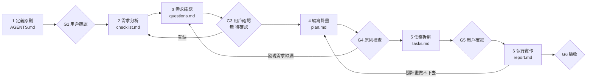

# SPEC-KIT

自用的規格驅動開發套件，目標是之後的 MES 系統開發。格式參考 GitHub Spec Kit，但流程、角色、範本都是自己的，不依賴 `.specify/`。

SPEC 的格式見 `spec-format.md`。完整範例見 `example-yogurtguide/`。

---

## 1. 總覽



| 步驟 | 誰做 | 產出 | 關卡（沒過不能往下） |
|---|---|---|---|
| 1 定義原則 | SPEC_BOSS 整理，用戶決定 | `AGENTS.md` | G1：用戶確認原則，沒有標「待確認」的原則擋到第 2 步 |
| 2 需求分析 | SPEC_SA | `checklist.md` | 品質檢查清單除了「無待確認」以外全勾 |
| 3 需求確認 | SPEC_BOSS 提問，用戶回答，SPEC_SA 寫回 | `questions.md`、更新後的 `checklist.md` | G3：沒有 `[待確認]`，用戶確認，狀態改「已確認」 |
| 4 編寫計畫 | SPEC_SA | `plan.md` | G4：SPEC_BOSS 確認原則檢查全過、每條 R 都有落點 |
| 5 任務拆解 | SPEC_SA | `tasks.md` | G5：每條 R 都有任務，用戶確認 |
| 6 執行實作 | 實作 Agent 執行，SPEC_BOSS 派工與驗收 | 程式碼、`report.md` | G6：每個任務的完成條件與 `checklist.md` 驗收全過 |

**退回規則**
- 任何步驟發現需求缺漏或衝突 → 退回第 3 步，不准在後面的步驟自己補。
- 已確認的 `checklist.md` 要改 → 版本＋1、寫變更紀錄、重跑第 3 步之後受影響的步驟。
- 實作時照計畫做不下去 → 停在該任務，退回第 4 步，不准自己換做法。

---

## 2. 角色

| 角色 | 是誰 | 負責 | 不負責 |
|---|---|---|---|
| 用戶（`AGENTS.md`） | 需求方本人 | 最高原則；回答問題；G1、G3、G5 的確認 | 寫規格 |
| SPEC_BOSS | skill `spec-boss` | 流程、關卡、提問、派工、驗收、變更控管 | 寫規格內容、計畫、程式 |
| SPEC_SA | skill `spec-sa` | 需求規格、技術計畫、任務清單 | 決定原則、自己回答待確認、寫程式 |
| 實作 Agent | 一般 AI Agent | 一次做一個任務、跑測試、回報 | 改規格、跳任務 |

- skill 資料夾名稱照規範用小寫加連字號：`spec-boss`、`spec-sa`。文件裡稱 SPEC_BOSS、SPEC_SA。
- 原則有衝突時，以 `AGENTS.md` 為準；`AGENTS.md` 寫得不清楚時，SPEC_BOSS 提問，不准自己解讀。

---

## 3. 每一步怎麼做

### 步驟 1 定義原則

1. SPEC_BOSS 讀現有的 `AGENTS.md`；沒有就用第 4 節的範本開一份草稿。
2. 從用戶的描述整理出原則，每條一句，附「為什麼」。
3. 不清楚、互相衝突、或只有用戶能決定的，標 `[待確認]`，一次最多問 5 題。
4. 用戶確認後，原則加上編號 `P-01`…，之後只能由用戶改。

### 步驟 2 需求分析（What／Why）

1. SPEC_SA 讀 `AGENTS.md` 與用戶的需求描述。
2. 照 `spec-format.md` 的 12 段寫 `checklist.md`。
3. 每條需求寫輸入、輸出、失敗時、驗收；邊界條件逐類寫。
4. 不知道的寫 `[待確認：問題]`，不自己補。
5. 不寫任何技術名詞。
6. 跑一次品質檢查清單，把結果寫在檔案裡。

### 步驟 3 需求確認

1. SPEC_BOSS 收集所有 `[待確認]`，加上自己用下面 5 類掃一遍的漏洞：
   - 範圍：有沒有寫「不做」、有沒有多出原則沒提的東西
   - 資料：唯一識別、關係、保存期限、版本
   - 狀態：先後順序、不能回頭的轉換、做到一半怎麼辦
   - 邊界：空值、上限、重複、時區、離線、外部失敗
   - 權限與稽核：誰能做、誰能看、要不要留紀錄
2. 依影響排序，一次最多問 5 題；每題附選項與建議答案。
3. 答案寫進 `questions.md`，SPEC_SA 寫回 `checklist.md` 對應的段落。
4. 重複直到沒有 `[待確認]`，請用戶確認（G3）。

### 步驟 4 編寫計畫（How）

1. SPEC_SA 讀已確認的 `checklist.md` 與 `AGENTS.md`。
2. 照 `spec-format.md` 的 14 段寫 `plan.md`。
3. 先寫「原則檢查」；有違反就寫理由與被否決的簡單做法，交 SPEC_BOSS 決定。
4. 每條 `R-xx` 在「需求落點」都有位置；沒有位置就是需求寫不清楚 → 退回第 3 步。
5. 技術選擇不確定的寫 `[待確認]`，由 SPEC_BOSS 問用戶。

### 步驟 5 任務拆解

1. SPEC_SA 依 `plan.md` 拆成 `T-001`…，格式見第 4 節。
2. 每個任務：
   - 只改一件事，30 分鐘到半天能完成
   - 有對應的 R 與完成條件（指令或可觀察的結果）
3. 依序排列：先基礎（資料結構、共用元件），再依需求優先序 P1 → P3。
4. 可並行的標 `[P]`（不同檔案、沒有相依）。
5. 每條 R 至少一個任務；每個任務至少對到一條 R。

### 步驟 6 執行實作

1. SPEC_BOSS 一次派一個任務給實作 Agent，附上：任務內容、對應的 R 與驗收、`plan.md` 相關段落。
2. 實作 Agent 只做這個任務，跑完成條件，回報結果。
3. SPEC_BOSS 檢查完成條件；通過就勾掉 `tasks.md`，並寫進 `report.md`。
4. 沒通過 → 同一任務重做最多 2 次；還不過就停下，寫進 `report.md`，交 SPEC_SA 改計畫（退回第 4 步）。
5. 全部完成後，用 `checklist.md` 的驗收逐條驗收（G6）。

---

## 4. 範本

### `AGENTS.md`（用戶的最高原則）

```markdown
# <專案名稱>

## 目的
<為什麼有這個專案，2–3 句>

## 原則
| 編號 | 原則 | 為什麼 |
|---|---|---|
| P-01 | <一句話> | <理由> |

## 不可以做
- <例如：不把憑證放進版控>

## 技術限制
- <既有系統、語言、部署環境、不可更換的元件>

## 敏感資料
- <哪些資料不能進 log、不能離開哪個系統>

## 審核方式
- 用戶確認的關卡：G1、G3、G5（可增減）
- 回答問題的人：<名字或角色>

## 原則待確認
- [待確認：<問題>]
```

### `questions.md`

```markdown
# 需求確認：<功能名稱>

| 編號 | 對應 | 問題 | 選項（★ 建議） | 答案 | 日期 |
|---|---|---|---|---|---|
| Q-01 | R-03 | <問題> | A ★ / B / C | <用戶答案> | YYYY-MM-DD |
```

### `tasks.md`

```markdown
# 任務：<功能名稱>

格式：`- [ ] T-001 [P] (R-01) <做什麼>（<檔案路徑>）— 完成條件：<指令或可觀察的結果>`

## 階段 1：基礎
- [ ] T-001 (R-02) 建立批次資料結構（src/content.config.ts）— 完成條件：npm run build 通過

## 階段 2：R-01（P1）
- [ ] T-002 [P] (R-01) …

## 對照
| R | 任務 |
|---|---|
| R-01 | T-002、T-003 |
```

### `report.md`

```markdown
# 實作紀錄：<功能名稱>

| 任務 | 結果 | 完成條件輸出 | 偏離與原因 |
|---|---|---|---|
| T-001 | 通過 | build 73 頁、0 錯誤 | 無 |
```

---

## 5. SKILL 草稿

確認後才建檔。放共用庫時，內容不放任何專案專用的名稱或範例；專案的規則放該專案的 `AGENTS.md`。

### `spec-boss/SKILL.md`

```markdown
---
name: spec-boss
description: "SPEC-KIT 的流程負責人（SPEC_BOSS）：整理原則、守 6 個步驟的關卡、向用戶提問、派任務給實作 Agent、驗收。使用者說「開新需求」「跑 SPEC-KIT」「需求確認」「開始實作」時使用。"
---

# SPEC_BOSS

**範圍**：流程、關卡、提問、派工、驗收、變更控管。
**不管**：規格內容、技術計畫、任務拆解、程式碼。看到問題就轉交 SPEC_SA。

## 一定要做

- 開始前讀專案 `AGENTS.md`。沒有就先做步驟 1。
- 每一步開始前確認上一個關卡已通過；沒通過就停下並說明缺什麼。
- `AGENTS.md` 不清楚或互相衝突時提問，不自己解讀。
- 提問一次最多 5 題，依影響排序，每題附選項與建議答案。
- 用戶的答案寫進 `questions.md`，並標日期。
- 派工一次一個任務，附對應的 R、驗收與計畫段落。
- 每個任務完成後核對完成條件，結果寫進 `report.md`。
- 發現需求缺漏或衝突就退回步驟 3。

## 絕對不能做

- 自己回答 `[待確認]`。
- 跳過關卡，或在 G1、G3、G5 沒有用戶確認時往下走。
- 自己寫或改 `checklist.md`、`plan.md`、`tasks.md` 的內容。
- 讓實作 Agent 一次做多個任務，或做清單外的事。
- 把專案專用的規則寫進這個 skill。

## 留下

1. 目前在第幾步、哪些關卡已過。
2. 待用戶回答的問題。
3. 轉交：`→ SPEC_SA：問題`。
4. 下一個動作。
```

### `spec-sa/SKILL.md`

```markdown
---
name: spec-sa
description: "SPEC-KIT 的系統分析（SPEC_SA）：寫需求規格 checklist.md、技術計畫 plan.md、任務清單 tasks.md。由 SPEC_BOSS 在步驟 2、4、5 叫用，或使用者要求寫規格、計畫、拆任務時使用。"
---

# SPEC_SA

**範圍**：`checklist.md`、`plan.md`、`tasks.md` 的內容。
**不管**：原則（屬於用戶）、提問與關卡（屬於 SPEC_BOSS）、寫程式（屬於實作 Agent）。

## 一定要做

- 先讀 `AGENTS.md`；照 `spec-format.md` 的段落寫。
- 每條需求寫：為什麼、優先序、輸入、輸出、失敗時、Given/When/Then 驗收。
- 定出狀態的先後順序；寫入是整筆成功或整筆不存。
- 邊界逐類寫：空值、零、負數、上限、格式錯、重複送出、日期或時區交界、離線、外部失敗。
- 加欄位或新資料時沿用現有結構，寫出版本號與舊資料怎麼讀回。
- 標出敏感資料。
- 不確定的寫 `[待確認：問題]`，交 SPEC_BOSS。
- `plan.md` 先做原則檢查；每條 R 都要有落點。
- `tasks.md` 每個任務對到 R、有完成條件、半天內能完成。

## 絕對不能做

- 在 `checklist.md` 寫技術名詞。
- 在 `plan.md` 或 `tasks.md` 加 `checklist.md` 沒有的需求。
- 加入需求沒提的外部依賴：帳號、伺服器、雲端、第三方服務。
- 多做用不到的介面、抽象層或設定項。
- 自己回答 `[待確認]`。

## 留下

1. 寫好或改過的檔案與版本。
2. 剩下的 `[待確認]`。
3. 拿掉的偏離（原始需求沒有的範圍）。
4. 轉交：`→ SPEC_BOSS：問題`。
```

---

## 6. MES 專用檢查（用在 MES 專案時加進步驟 3 的掃描）

| 類別 | 要問清楚的事 |
|---|---|
| 工單與狀態 | 狀態清單、允許的轉換、誰能暫停／取消、取消後資料怎麼處理 |
| 追溯 | 批號、序號、原料批與成品批的族譜；往前與往後追溯要多快 |
| 稽核軌跡 | 誰在何時改了什麼、改前改後；紀錄能不能刪（通常不能） |
| 電子簽核 | 哪些動作要簽核、幾層、簽核後能不能改 |
| 設備介面 | 資料來源（PLC、SCADA、人工）、頻率、斷線時的暫存與補傳、重複資料去重 |
| 班別與時間 | 班別切換、跨日歸屬、時區、伺服器與設備時鐘不同步 |
| 主資料 | 料號、BOM、途程的版本；生產中途改版本怎麼辦 |
| 離線 | 現場網路斷線時能做什麼、恢復後怎麼合併 |
| 權限 | 角色、站點、產線的權限範圍 |
| 保存與報表 | 資料保存年限、法規要求、報表的資料截止時間 |

範例的對應：YogurtGuide 的「批次」相當於工單／批號，「傳代線」相當於批號族譜，「發酵 → 冷藏 → 完成」相當於工單狀態。

---

## 7. 與 GitHub Spec Kit 的對照

| 官方 | 這套 | 差異 |
|---|---|---|
| `constitution.md` | `AGENTS.md` | 原則由用戶擁有，SPEC_BOSS 只整理與提問 |
| `/speckit-specify` → `spec.md` | 步驟 2 → `checklist.md` | 規格與品質檢查清單放同一份 |
| `/speckit-clarify` | 步驟 3 → `questions.md` | 問答另存一份，可追溯誰在何時決定 |
| `/speckit-plan` → `plan.md`、`research.md`、`data-model.md`、`contracts/` | 步驟 4 → `plan.md` | 合成一份，段落固定 14 段 |
| `/speckit-tasks` | 步驟 5 → `tasks.md` | 每個任務必須有完成條件與 R 對照 |
| `/speckit-implement` | 步驟 6 → `report.md` | 一次一個任務、SPEC_BOSS 逐項驗收 |
| `/speckit-analyze`、`/speckit-checklist` | G4、G5 關卡 | 不另設指令，併入關卡檢查 |
| 依賴 `.specify/` 腳本與分支命名 | 不依賴 | 純 Markdown，任何 Agent 都能用 |

---

## 8. 檔案位置

```text
<專案>/
├── AGENTS.md                 # 用戶的最高原則
└── specs/
    └── 001-<短名>/
        ├── checklist.md      # 步驟 2、3
        ├── questions.md      # 步驟 3
        ├── plan.md           # 步驟 4
        ├── tasks.md          # 步驟 5
        └── report.md         # 步驟 6

<共用庫>/
├── spec-boss/SKILL.md
├── spec-sa/SKILL.md
└── spec-kit/                 # spec-format.md 與上面 4 個範本
```
